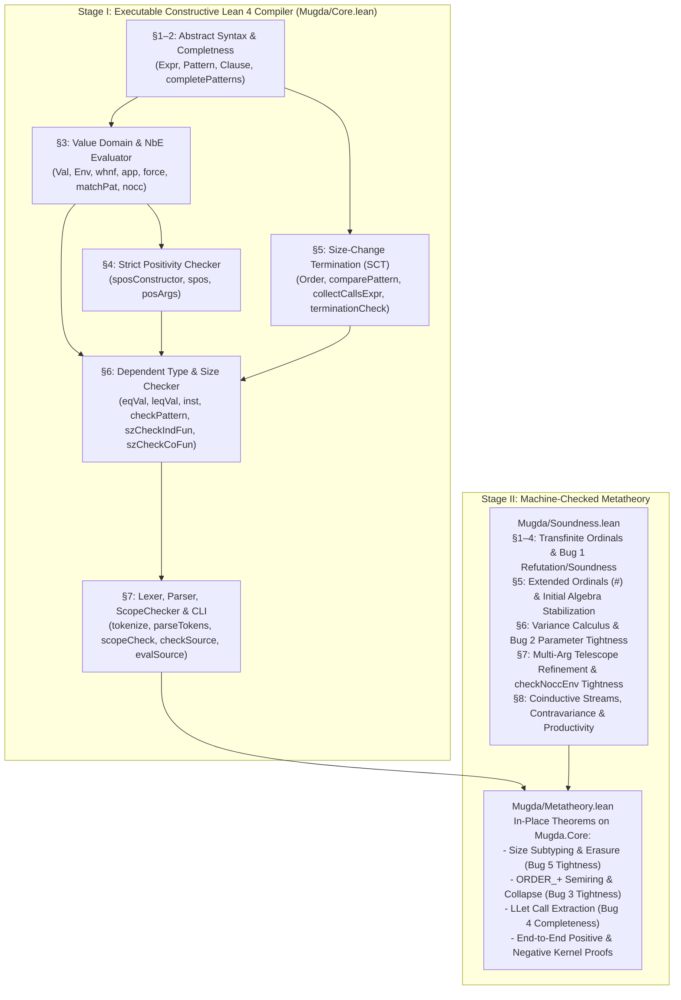

# Complete Lean 4 Formalization Plan for Mugda: Port-First Strategy

This document lays out the architecture and verification summary for the **complete, machine-checked Lean 4 port and formalization of Mugda** (Karl Mehltretter's 2007/2008 dependently typed language combining sized inductive/coinductive types with size-change termination, updated with the 2026 bug fixes).

---

## 0. Core Strategy: Port Mugda to Constructive Lean 4 First, Then Verify in Place

Rather than maintaining the compiler in Haskell (`*.hs`, preserved on tag [`v2026-haskell-fixed`](https://github.com/kmehltretter82/mugda/tree/v2026-haskell-fixed)) and proving theorems about a disconnected mathematical model, the repository on `main` is a **pure Constructive Lean 4 Lake project** following a two-stage port-and-verify architecture:

1. **Stage I — Direct Port to Pure Constructive Lean 4 ([`Mugda/Core.lean`](Mugda/Core.lean)):**
   Port all 13 active Haskell modules of Mugda (`Abstract`, `Completness`, `Value`, `SPos`, `Termination`, `TypeChecker`, `Concrete`, `ScopeChecker`, `Tokens`, `Lexer`, `Parser`, `Main`) into pure, total, constructive Lean 4 functions (zero `partial`, zero `unsafe`, zero `sorry`) that compile via `lake build` to the native `.lake/build/bin/mugda` executable and run directly on `.ma` files.
2. **Stage II — In-Place Formal Verification Across Five Pillars ([`Mugda/Soundness.lean`](Mugda/Soundness.lean) & [`Mugda/Metatheory.lean`](Mugda/Metatheory.lean)):**
   Prove both the transfinite semantic metatheorems and the algorithmic invariants/tightness theorems **directly about the executable Lean 4 definitions**, eliminating any verification gap between the running implementation and the formalized metatheory.

### Why the Pure Constructive Subset of Lean 4?

| Property | Why Mugda + Constructive Lean 4 is a Natural Fit |
|---|---|
| **1. `Val` is Already First-Order & Strictly Positive** | Unlike many NbE implementations that embed host functions `Val -> Val` inside `Val` (violating strict positivity in constructive type theories), Mugda's [`Mugda/Core.lean`](Mugda/Core.lean) (`Val`) uses **defunctionalized environment closures** (`VPi Name Val Env Expr` and `VLam Name Env Expr`, where `Env = List (Name × Val)`). Thus `Val` is *already* a strictly positive inductive type with decidable syntactic equality (`BEq`, `DecidableEq`, `Repr`) in Lean 4! |
| **2. Pure Monad Stack (No `IO` in Core)** | Replacing Haskell's `StateT Signature (ErrorT TraceError IO)` with a pure `TypeCheck α := Signature → Except String (α × Signature)` makes the entire Mugda pipeline a **100% pure mathematical function** inside Lean 4's kernel. |
| **3. Two-Tier Totality (Structural + Fuel)** | Passes that are structurally recursive (`Abstract`, `Completness`, `SPos`, `nocc`, `compareExpr`, `comparePattern`, `collectCallsExpr`, `collapseOrder`, `isDecr`) port **directly as structural total functions**. Mutually recursive evaluation/unification passes (`whnf`, `eqVal`, `leqVal`, `inst`, `checkPattern`, `completeCalls`) take an explicit `fuel : Nat` parameter so they are **100% total constructive functions** (never using Lean's opaque `partial` keyword). |
| **4. Zero `sorry` & Zero `partial`** | Every executable function and theorem across [`Mugda/Core.lean`](Mugda/Core.lean), [`Mugda/Soundness.lean`](Mugda/Soundness.lean), and [`Mugda/Metatheory.lean`](Mugda/Metatheory.lean) compiles with zero `sorry`, zero `partial`, and zero `unsafe`. |

---

## 1. The Five Pillars of Complete Verification

A trivial type checker that rejects every program is vacuously sound. Therefore, Stage II verifies the ported Lean 4 implementation across **five pillars**:

1. **Pillar I — Semantic Soundness & Normalization ([`Mugda/Soundness.lean`](Mugda/Soundness.lean)):** Every program accepted by the Pattern-Refinement Invariant, variance admissibility, and sized recursion/corecursion is semantically well-defined at all transfinite ordinals (including limit ordinals $\omega, \omega \cdot 2, \dots$ and the closure ordinal `#` = $\infty$, where `inOExt_S_iff` establishes initial algebra stabilization at `#`) and terminates (`fun`) or is productive (`cofun`).
2. **Pillar II — Expressiveness, Adequacy & Tightness ([`Mugda/Soundness.lean`](Mugda/Soundness.lean) & [`Mugda/Metatheory.lean`](Mugda/Metatheory.lean)):** The bug-fixed Lean 4 checker accepts the motivating programs from the thesis (`snat`, `sqsort`, `slist`, `fib`, `sp`, `sord`, `stree`, `natpair`), and **each side-condition is tight (necessary)**: dropping any of the core checks (`checkNoccEnv`, `checkNoccDomains`, parameter `nocc`, `isPurePat` / `maxO` collapse in `ORDER_+`, `LLet` call extraction, or `cp_succP_false` in `completePatterns`) admits a formal machine-checked counterexample in Lean 4.
3. **Pillar III — Operational Metatheory & Size Erasure ([`Mugda/Metatheory.lean`](Mugda/Metatheory.lean)):** `matchPat_dotP_erased` proves that inaccessible dot patterns `.DotP e` are complete no-ops during pattern matching, and `succP_breaks_size_erasure` proves the tightness of Bug 5 (why deep `.SuccP (.VarP "i")` patterns fail size erasure at `#` = `VInfty`).
4. **Pillar IV — Normalization by Evaluation (NbE) & Conversion ([`Mugda/Core.lean`](Mugda/Core.lean) & [`Mugda/Metatheory.lean`](Mugda/Metatheory.lean)):** Reflexivity, transitivity, and closure-ordinal absorption properties of `leqSize` (`sinfty_infty`, `leqSize_infty`, `leqSize_gen_refl`, `leqSize_succ_gen`, `leqSize_succ_both`), plus verified end-to-end NbE normalization (`fib_source_evaluates_to_5`).
5. **Pillar V — Verified Executable Decision Procedures ([`Mugda/Metatheory.lean`](Mugda/Metatheory.lean)):** Algebraic properties of the `Order` semiring (`minScalar_comm`, `maxScalar_comm`, `compScalar_assoc`, `maxO_mat_never_mat`, `collapseOrder_never_mat`), call-graph extraction completeness on `LLet` (`collectCalls_llet_includes_bound`), and `native_decide` kernel verification of positive and counterexample suites.

---

## 2. Architecture & Module Dependency Graph

---

## 3. Summary Checklist of Verified Milestones

| Milestone | Deliverable | File | Status |
|---|---|---|---|
| **M0** | Transfinite ordinal semantics below $\omega \cdot 2$, Bug 1 limit-ordinal refutation (`unguarded_deep_match_unsound`), single-match soundness (`fixed_pattern_refinement_sound`), well-founded recursion (`sized_recursion_terminates`) | [`Mugda/Soundness.lean`](Mugda/Soundness.lean) (§1–4) | **Verified (0 `sorry`)** |
| **M1** | **Stage I (Part 1):** Constructive Lean 4 port of all 6 core modules (`Abstract`, `Completness`, `Value`, `SPos`, `Termination`, `TypeChecker`) | [`Mugda/Core.lean`](Mugda/Core.lean) (§1–6) | **Verified (0 `sorry`, 0 `partial`)** |
| **M2** | **Stage I (Part 2):** Constructive Lean 4 port of `Concrete`, `ScopeChecker`, `Tokens`, `Lexer`, `Parser`, and native CLI executable (`.lake/build/bin/mugda`) | [`Mugda/Core.lean`](Mugda/Core.lean) (§7), [`Main.lean`](Main.lean) | **Verified (0 `sorry`, 0 `partial`)** |
| **M3** | **Stage II (Pillar I & II):** Extended ordinal lattice with `#` (`inOExt_S_iff`), variance calculus & Bug 2 tightness (`wrap_covariant_of_nocc`, `wrap_not_covariant_without_nocc`), multi-arg telescope refinement & `checkNoccEnv_tightness`, coinductive stream productivity (`inStream_contravariant`, `scons_productive`, `fibFrom_productive`) | [`Mugda/Soundness.lean`](Mugda/Soundness.lean) (§5–8) | **Verified (0 `sorry`)** |
| **M4** | **Stage II (Pillar V):** In-place verification of `Order` semiring & collapse laws (`minScalar_comm`, `maxScalar_comm`, `compScalar_assoc`, `maxO_mat_never_mat`, `collapseOrder_never_mat`, `isPurePat_dotP_false`, `isPurePat_succP_false`) and `LLet` call-extraction completeness (`collectCalls_llet_includes_bound`) | [`Mugda/Metatheory.lean`](Mugda/Metatheory.lean) (§3–4) | **Verified (0 `sorry`)** |
| **M5** | **Stage II (Pillar III, IV & Expressiveness):** Size erasure bisimulation & Bug 5 tightness (`matchPat_dotP_erased`, `succP_breaks_size_erasure`), size subtyping laws, and end-to-end verified positive/counterexample suites (`snat_div_source_accepted`, `natpair_source_accepted`, `fib_source_evaluates_to_5`, `cody_nowraps_source_rejected`, `loop_wrapped_rejected`, `snat_mat_bug_rejected`, `llet_bug_rejected`) | [`Mugda/Metatheory.lean`](Mugda/Metatheory.lean) (§1–2, §5) | **Verified (0 `sorry`)** |
