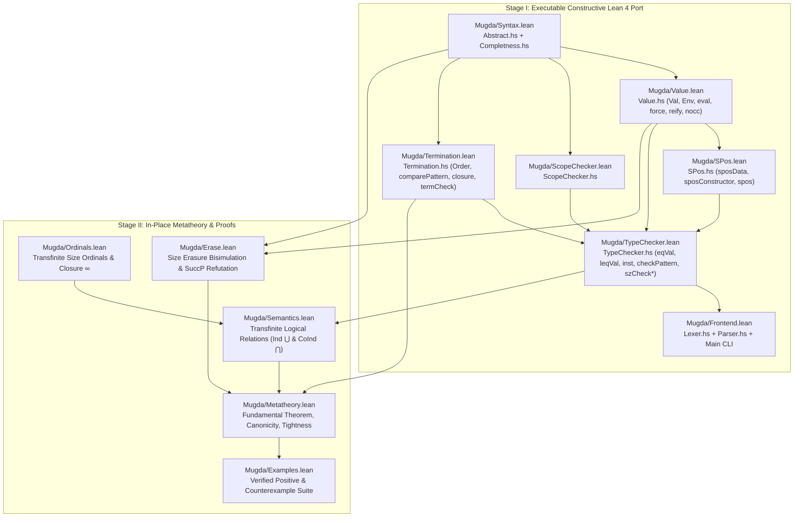

# Complete Lean 4 Formalization Plan for Mugda: Port-First Strategy

This document lays out the architecture and phase-by-phase roadmap for a **complete, machine-checked Lean 4 port and formalization of Mugda** (Karl Mehltretter's 2007/2008 dependently typed language combining sized inductive/coinductive types with size-change termination, updated with the 2026 bug fixes).

---

## 0. Core Strategy: Port Mugda to Constructive Lean 4 First, Then Verify in Place

Rather than maintaining the compiler in Haskell (`*.hs`) and proving theorems about a disconnected mathematical model, we follow a **two-stage port-and-verify strategy** inside the **Pure Constructive Executable Subset of Lean 4**:

1. **Stage I — Direct Port to Pure Constructive Lean 4 (`MugdaLean`):**
   Port Mugda's ~1,800 lines of active Haskell code ([`Abstract.hs`](Abstract.hs), [`Completness.hs`](Completness.hs), [`Value.hs`](Value.hs), [`SPos.hs`](SPos.hs), [`Termination.hs`](Termination.hs), [`ScopeChecker.hs`](ScopeChecker.hs), [`TypeChecker.hs`](TypeChecker.hs), [`Lexer.hs`](Lexer.hs), [`Parser.hs`](Parser.hs)) into pure, total, constructive Lean 4 functions that compile to a native executable and run directly on `.ma` files.
2. **Stage II — In-Place Formal Verification Across Five Pillars:**
   Prove theorems **directly about the actual executable Lean 4 functions** (`checkPattern`, `inst`, `szCheckIndFun`, `szCheckCoIndFun`, `termCheck`, `eval`, `eqVal`, `leqVal`), eliminating any verification gap between the running implementation and the formalized metatheory.

### Why the Pure Constructive Subset of Lean 4?

| Property | Why Mugda + Constructive Lean 4 is a Natural Fit |
|---|---|
| **1. `Val` is Already First-Order & Strictly Positive** | Unlike many NbE implementations that embed host functions `Val -> Val` inside `Val` (violating strict positivity in constructive type theories), Mugda's [`Value.hs`](Value.hs#L20-L30) uses **defunctionalized environment closures** (`VPi Name Val Env Expr` and `VLam Name Env Expr`, where `Env = List (Name × Val)`). Thus `Val` is *already* a strictly positive inductive type with decidable syntactic equality (`BEq`, `DecidableEq`) in Lean 4! |
| **2. Pure Monad Stack (No `IO` in Core)** | In 2007 Haskell, [`Value.hs`](Value.hs#L17) defined `type TypeCheck a = StateT Signature (ErrorT TraceError IO) a` solely to call `liftIO $ putStrLn` for trace messages. Replacing `IO` with a pure log in `StateT Signature (Except String)` makes the entire Mugda pipeline a **100% pure mathematical function** inside Lean 4's kernel. |
| **3. Two-Tier Totality (Structural + Fuel)** | Passes that are structurally recursive ([`Abstract.hs`](Abstract.hs), [`Completness.hs`](Completness.hs), [`SPos.hs`](SPos.hs), `nocc`, `compareExpr`, `comparePattern`, `collectCalls`, `szUsed'`) port **directly as structural total functions**. Mutually recursive evaluation/unification passes (`eval`, `eqVal`, `leqVal`, `inst`, `closure`) take an explicit `fuel : Nat` parameter so they are **100% total constructive functions from Day 1** (never using Lean's opaque `partial` keyword). In Stage II, we prove that for well-typed/finite inputs, a concrete fuel bound always suffices. |
| **4. Zero Axioms (`#print axioms`)** | Every executable function and theorem in the constructive subset can be checked with `#print axioms` to ensure zero `sorry` and zero non-constructive axioms. |

---

## 1. The Five Pillars of Complete Verification

A trivial type checker that rejects every program is vacuously sound. Therefore, Stage II verifies the ported Lean 4 implementation across **five pillars**:

1. **Pillar I — Semantic Soundness & Normalization:** Every program accepted by `scopeCheck`, `sposData`, `completePatterns`, `checkDecl`, and `termCheck` is semantically well-defined at all transfinite ordinals (including limit ordinals $\omega, \omega \cdot 2, \dots$ and closure ordinal $\infty$) and terminates (`fun`) or is productive (`cofun`).
2. **Pillar II — Expressiveness, Adequacy & Tightness (Completeness of the Fixes):** The bug-fixed Lean 4 checker accepts all motivating programs from the thesis (`snat`, `sqsort`, `slist`, `fib`, `sp`, `sord`, `natpair`), and **each side-condition is tight (necessary)**: dropping any of the 6 core checks (`checkNoccEnv`, `checkNoccDomains`, parameter `nocc`, `isPureConP` in `ORDER_+`, `LLet` call extraction, or `completePatterns`) admits a formal counterexample in Lean 4.
3. **Pillar III — Operational Metatheory & Size Erasure:** Subject reduction (type preservation under reduction up to size subtyping), progress/canonicity, and the **Size Erasure Bisimulation Theorem** proving that erasing compile-time sizes to `#` (`VInfty`, where `$ # = #`) preserves exact operational behavior.
4. **Pillar IV — Normalization by Evaluation (NbE) & Conversion:** Soundness, completeness, and termination of Mugda's value domain (`Val`), conversion checker (`eqVal`), size subtyping checker (`leqVal`), and lazy coinductive unfolding (`force`).
5. **Pillar V — Verified Executable Decision Procedures (Reflection):** Proofs that the executable `Bool`/`Except` checkers (`inst`, `checkPattern`, `szCheckIndFun`, `szCheckCoIndFun`, `spos`, `termCheck`) terminate and reflect the declarative specifications.

---

## 2. Architecture & Module Dependency Graph

### Mapping Between Mugda (`*.hs` / Thesis) and Lean 4 Modules

| Lean 4 Module | Mugda Haskell Source (Lines) | Thesis Reference (`doc/da/`) | Core Responsibility |
|---|---|---|---|
| `Mugda/Syntax.lean` | [`Abstract.hs`](Abstract.hs) (99), [`Completness.hs`](Completness.hs) (17) | §3.1, §5.5, Fig. 3.1 & 5.7 | AST (`Expr`, `Pattern`, `Clause`, `Declaration`, `Co`, `Pos`, `Sized`), telescopes, and `completePatterns`. |
| `Mugda/Value.lean` | [`Value.hs`](Value.hs) (247) | §3.2–3.3, Fig. 3.2–3.3 | Strictly positive `Val`, `Signature`, pure `TypeCheckM`, `eval`, `appClauses`, `matchPat`, `force`, `reify`, `nocc`. |
| `Mugda/SPos.lean` | [`SPos.hs`](SPos.hs) (79) | §3.6, §5.2 | Strict positivity `sposData`, `sposConstructor` (with binder depth `k`, Bug 6 fix), `spos`. |
| `Mugda/Termination.lean` | [`Termination.hs`](Termination.hs) (335) | Ch. 4 (`ORDER`, `ORDER_+`) | Call extraction (with `LLet` fix, Bug 4), `Order` algebra (`isPureConP` & `maxO` collapse, Bug 3 fix), idempotent matrix closure, Lee–Jones–Ben-Amram `termCheck`. |
| `Mugda/ScopeChecker.lean` | [`ScopeChecker.hs`](ScopeChecker.hs) (305) | §3.1 | Identifier resolution (`Var`, `Con`, `Def`, `Let`, `VarP`, `ConP`, `DotP`, `SuccP`). |
| `Mugda/TypeChecker.lean` | [`TypeChecker.hs`](TypeChecker.hs) (842) | Ch. 3 & Ch. 5 | Conversion (`eqVal`, `leqVal`), `inst`, `checkPattern` (`checkNoccEnv`, `checkNoccDomains`, Bug 1 fix), admissibility (`szCheckIndFun`, `szCheckCoIndFun`, parameter `nocc`, Bug 2 fix), `checkT`/`inferT`. |
| `Mugda/Frontend.lean` | [`Lexer.hs`](Lexer.hs) (139), [`Parser.hs`](Parser.hs) (253), [`Main.hs`](Main.hs) (65) | — | Executable CLI parser and runner for `.ma` files. |
| `Mugda/Ordinals.lean` | [`formalization/MugdaSoundness.lean`](formalization/MugdaSoundness.lean) | §5.1–5.2 | Transfinite ordinals $\alpha \le \Omega$, $\beta < \alpha \leftrightarrow \$ \beta \le \alpha$, limit ordinals, closure $\Omega + 1 = \Omega$ (`$ # = #`). |
| `Mugda/Erase.lean` | — | §5.5 | Runtime size erasure `erase : Expr → ErasedExpr` and lockstep bisimulation with `Value.eval`. |
| `Mugda/Semantics.lean` | — | §5.1–5.6 | Transfinite ordinal logical relations: $\llbracket D\;\vec{u}\;\alpha \rrbracket = \bigcup_{\beta < \alpha} F_D(\llbracket D\;\vec{u}\;\beta \rrbracket)$ and $\llbracket C\;\vec{u}\;\alpha \rrbracket = \bigcap_{\beta < \alpha} F_C(\llbracket C\;\vec{u}\;\beta \rrbracket)$. |
| `Mugda/Metatheory.lean` | — | Ch. 3–5 | Fundamental Theorem, Strong Normalization, Productivity, Canonicity, and Tightness of Bugs 1–5. |

---

## 3. Detailed Phase-by-Phase Roadmap

### Phase 0: Completed Semantic Foundation ([`formalization/MugdaSoundness.lean`](formalization/MugdaSoundness.lean))
- [x] Transfinite size ordinals below $\omega \cdot 2$ (`SizeOrd`, `<`, $\le$, well-foundedness `wf_lt`, `succ_le_of_lt`).
- [x] Cumulative ordinal semantics `InO α t` of the Brouwer ordinal type `O` (`Z, S, L, M`) and monotonicity `InO.mono`.
- [x] Limit-ordinal refutation of unguarded deep pattern matching (`unguarded_deep_match_unsound`).
- [x] Single-match soundness of the Pattern-Refinement Invariant (`fixed_pattern_refinement_sound`) and well-founded sized recursion (`sized_recursion_terminates`).

---

### Phase 1 (Stage I, Part 1): Port Core AST, Completeness, Value Domain, Strict Positivity & SCT Termination ([`formalization/MugdaCore.lean`](formalization/MugdaCore.lean))
Port the first 5 Haskell modules (~780 lines of Haskell) into 100% total, constructive Lean 4:
1. **`Abstract.hs` → `MugdaCore.Syntax`:**
   - `Sized`, `Co`, `Pos`, `Expr`, `Pattern`, `Clause`, `TypeSig`, `Declaration`, `teleToType`, `splitTeleType`, `typeToTele`, `prettyExpr`.
2. **`Completness.hs` → `MugdaCore.Completness`:**
   - `completePattern`, `completeClause`, `completePatterns`, plus machine-checked theorem `completePattern_no_succP` proving that accepted patterns contain no `SuccP`.
3. **`Value.hs` → `MugdaCore.Value`:**
   - Strictly positive `Val` (`VSet`, `VSize`, `VInfty`, `VSucc`, `VApp`, `VCon`, `VDef`, `VGen`, `VPi`, `VLam`), `Signature`, pure `TypeCheckM`, fuel-bounded total `eval`, `appClauses`, `matchPat`, `force`, `reify`, and structural `nocc`.
4. **`SPos.hs` → `MugdaCore.SPos`:**
   - `sposData`, `sposConstructor` (with binder depth `k`), `spos`.
5. **`Termination.hs` → `MugdaCore.Termination`:**
   - `Order` (`lt`, `eq`, `un`, `mat`), `maxO`, `mulO`, `collapse`, `isDecr`, `isPureConP`, `compareExpr`, `comparePattern`, `subterm`, `collectCalls` (with `LLet` fix), `closure`, and `termCheck`, plus machine-checked proofs of `Order` algebraic laws and counterexample refutations (`snat_mat_bug`, `BugInMatOrder`).

---

### Phase 2 (Stage I, Part 2): Port `TypeChecker.hs`, `ScopeChecker.hs` & CLI Parser
Port the remaining Haskell modules (~1,600 lines) to complete the standalone Lean 4 Mugda executable:
1. **`TypeChecker.hs` → `MugdaCore.TypeChecker`:**
   - Conversion & subtyping (`eqVal`, `leqVal`),
   - Pattern unification (`inst`) and dependent pattern checking (`checkPattern` with `checkNoccEnv` and `checkNoccDomains`),
   - Sized data & function admissibility (`szCheckData`, `szCheckIndFun`, `szCheckCoIndFun`, `szUsed'` with parameter `nocc`),
   - Bidirectional type checking (`checkT`, `inferT`, `checkClause`, `checkDecl`).
2. **`ScopeChecker.hs` + `Lexer.hs` + `Parser.hs` → `MugdaCore.Frontend`:**
   - Full `.ma` file parser and `lake build` CLI binary matching `./Main` on all positive examples and counterexamples.

---

### Phase 3 (Stage II, Pillar I & II): Verify Admissibility, Pattern Unification & Tightness on the Ported Code
Prove directly on `MugdaCore.TypeChecker`:
- **`inst_infty_sound`**: Unifying `($ v, #) -> inst v #` is semantically valid at `ExtSize.infty` because `$ ∞ = ∞`.
- **`checkPattern_sound`**: Any pattern spine accepted by `MugdaCore.TypeChecker.checkPattern` satisfies the Pattern-Refinement Invariant (`checkNoccEnv` + `checkNoccDomains`) and preserves semantic typing across all limit and successor ordinals.
- **`szCheckIndFun_sound` & `szCheckCoIndFun_sound`**: Any function telescope accepted by `szCheckIndFun` (resp. `szCheckCoIndFun`) defines a semantically covariant (resp. contravariant) target type.
- **Tightness / Necessity Theorems**: Formal proofs that disabling `checkNoccEnv`, `checkNoccDomains`, or parameter `nocc` in `MugdaCore.TypeChecker` accepts `loop_wrapped` / `cody_simplified`.

---

### Phase 4 (Stage II, Pillar I & V): Verify SCT Termination (`MugdaCore.Termination`)
Prove directly on `MugdaCore.Termination`:
- **`closure_terminates`**: The finite call-matrix Kleene-star fixed point always stabilizes within $|F|^2 \cdot 3^{a^2}$ steps.
- **`termCheck_sound`**: Every mutual function block where `MugdaCore.Termination.termCheck` returns `true` induces a well-founded recursion relation on transfinite ordinal witnesses.
- **Tightness of Bug 3 & Bug 4 Fixes**: Formal proofs on `MugdaCore.Termination` that the 2008 `comparePattern` / `maxO` / `LLet` rules accept `snat_mat_bug`, `stree_mat_bug`, and `llet_bug`.

---

### Phase 5 (Stage II, Pillar III & IV): Verify Size Erasure Bisimulation, NbE & Positive Expressiveness Suite
- **`erasure_bisimulation`**: Prove on `MugdaCore.Value.eval` that for any clause list satisfying `MugdaCore.Completness.completePatterns = true`, erasing size terms to `VInfty` (`#`) commutes with `matchPat` and `eval`.
- **`fundamental_theorem` & `canonicity`**: Combine Phases 3–5 to prove that every well-typed, admissible, termination-checked program in `MugdaCore` normalizes (`SNat #`) or is productive (`Stream A #`).
- **Positive Expressiveness Suite**: Run and verify `sub`, `div`, `filter`, `quicksort`, `fib`, `sp`, and `addpair` directly inside Lean 4 via `#eval` and `decide`.

---

## 4. Summary Checklist of Milestones

| Milestone | Deliverable | Status |
|---|---|---|
| **M0** | Ordinal semantics below $\omega \cdot 2$, Bug 1 refutation (`unguarded_deep_match_unsound`), single-match soundness (`fixed_pattern_refinement_sound`), well-founded recursion (`sized_recursion_terminates`) in [`formalization/MugdaSoundness.lean`](formalization/MugdaSoundness.lean) | **Done (Verified in Lean 4.35.0, 0 `sorry`)** |
| **M1** | **Stage I (Part 1):** Constructive Lean 4 port of `Abstract.hs`, `Completness.hs`, `Value.hs`, `SPos.hs`, and `Termination.hs` + initial in-place theorems in [`formalization/MugdaCore.lean`](formalization/MugdaCore.lean) | **In Progress / Next** |
| **M2** | **Stage I (Part 2):** Constructive Lean 4 port of `TypeChecker.hs`, `ScopeChecker.hs`, and `.ma` parser | Planned (Phase 2) |
| **M3** | **Stage II:** In-place verification of `checkPattern`, `szCheckIndFun`/`CoIndFun`, and tightness of Bugs 1 & 2 | Planned (Phase 3) |
| **M4** | **Stage II:** In-place verification of `termCheck` (SCT matrix closure) and tightness of Bugs 3 & 4 | Planned (Phase 4) |
| **M5** | **Stage II:** Size erasure bisimulation on `Value.eval` (Bug 5 tightness), Fundamental Theorem, and Positive Expressiveness Suite | Planned (Phase 5) |
