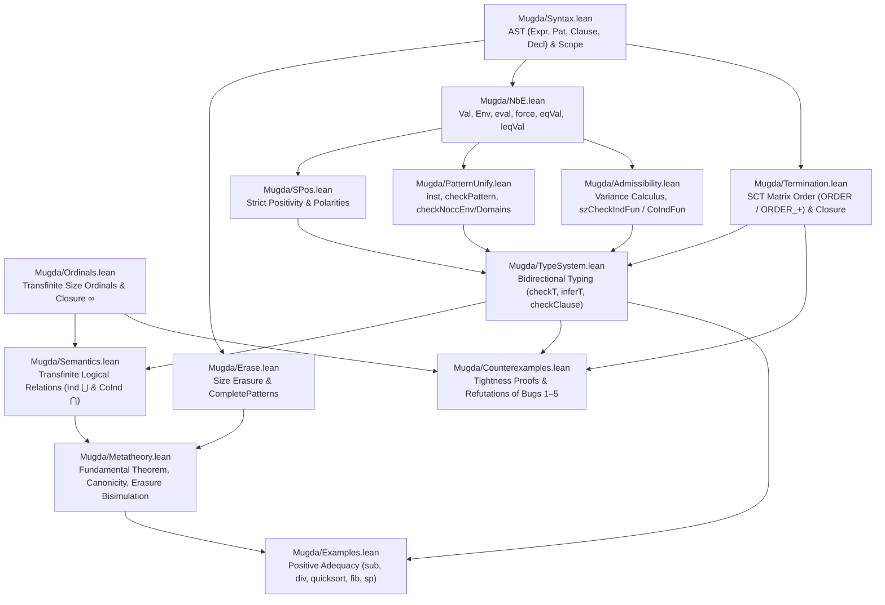

# Complete Lean 4 Formalization Plan for Mugda

This document lays out the architecture and phase-by-phase roadmap for a **complete, machine-checked Lean 4 formalization of Mugda** (Karl Mehltretter's 2007/2008 dependently typed language combining sized inductive/coinductive types with size-change termination, updated with the 2026 bug fixes).

A trivial type checker that rejects every program is vacuously sound. Therefore, a complete formalization of Mugda must go beyond soundness alone and establish **five pillars**:

1. **Pillar I — Semantic Soundness & Normalization:** Every well-typed, admissible, termination-checked program is semantically well-defined at all transfinite ordinals (including limit ordinals $\omega, \omega \cdot 2, \dots$ and closure ordinal $\infty$) and terminates (inductive `fun`) or is productive (coinductive `cofun`).
2. **Pillar II — Expressiveness, Adequacy & Tightness (Completeness of the Fixes):** The bug-fixed rules accept all motivating programs from the thesis (`snat`, `sqsort`, `slist`, `fib`, `sp`, `sord`, `natpair`), and **each side-condition is tight (necessary)**: dropping any of the 6 core checks (`checkNoccEnv`, `checkNoccDomains`, parameter `nocc`, `isPureConP` in `ORDER_+`, `LLet` call extraction, or `completePatterns`) admits a formal counterexample in Lean 4.
3. **Pillar III — Operational Metatheory & Size Erasure:** Subject reduction (type preservation under reduction up to size subtyping), progress/canonicity, and the **Size Erasure Bisimulation Theorem** proving that erasing compile-time sizes to `#` (`VInfty`, where `$ # = #`) preserves exact operational behavior.
4. **Pillar IV — Normalization by Evaluation (NbE) & Conversion:** Soundness, completeness, and termination of Mugda's value domain (`Val`), conversion checker (`eqVal`), size subtyping checker (`leqVal`), and lazy coinductive unfolding (`force`).
5. **Pillar V — Verified Executable Decision Procedures (Reflection):** Executable Lean 4 implementations of pattern unification (`inst`), pattern checking (`checkPattern`), admissibility (`szCheckIndFun` / `szCheckCoIndFun`), strict positivity (`spos`), and size-change matrix closure (`termCheck`), with proofs that the algorithms terminate and reflect the declarative specifications.

---

## 1. Architecture & Module Dependency Graph

The formalization is organized as a self-contained Lean 4 package inside `formalization/` (building on the existing foundation in [`formalization/MugdaSoundness.lean`](formalization/MugdaSoundness.lean)):



### Mapping Between Mugda (`*.hs` / Thesis) and Lean 4 Modules

| Lean 4 Module | Mugda Haskell Source | Thesis Reference (`doc/da/`) | Core Responsibility |
|---|---|---|---|
| `Mugda/Ordinals.lean` | `Value.hs` (`VSucc`, `VInfty`) | §5.1–5.2 | Transfinite ordinals $\alpha \le \Omega$, $\beta < \alpha \leftrightarrow \$ \beta \le \alpha$, limit ordinals, closure $\Omega + 1 = \Omega$ (`$ # = #`). |
| `Mugda/Syntax.lean` | [`Abstract.hs`](Abstract.hs), [`ScopeChecker.hs`](ScopeChecker.hs) | §3.1, Fig. 3.1 | Well-scoped syntax for `Expr`, `Pat`, `Clause`, `DataTel`, `CoInd`, `Pol`. |
| `Mugda/Erase.lean` | [`Completness.hs`](Completness.hs), [`Value.hs`](Value.hs) | §5.5, Fig. 5.7 | `completePatterns` (no `SuccP`) and runtime size erasure `erase : Expr → UntypedExpr`. |
| `Mugda/NbE.lean` | [`Value.hs`](Value.hs), [`TypeChecker.hs`](TypeChecker.hs) | §3.2–3.4, Fig. 3.2–3.4 | Semantic values `Val`, `eval`, coinductive `force`, `reify`, `eqVal`, `leqVal`. |
| `Mugda/SPos.lean` | [`SPos.hs`](SPos.hs) | §3.6, §5.2 | Strict positivity `sposConstructor` (with binder depth `k`, Bug 6 fix) and functorial monotonicity. |
| `Mugda/PatternUnify.lean` | [`TypeChecker.hs`](TypeChecker.hs) (`checkPattern`, `inst`) | §3.5, Fig. 3.6, §5.6 | Dependent pattern checking, `inst`, and the Pattern-Refinement Invariant (`checkNoccEnv`, `checkNoccDomains`, Bug 1 fix). |
| `Mugda/Admissibility.lean` | [`TypeChecker.hs`](TypeChecker.hs) (`szCheckIndFun`, `szCheckCoIndFun`) | §5.3–5.5, Fig. 5.6, Fig. 5.8 | Variance calculus, parameter `nocc` check (`rargs`, Bug 2 fix), inductive & coinductive admissibility. |
| `Mugda/Termination.lean` | [`Termination.hs`](Termination.hs) | Ch. 4 (`ORDER`, `ORDER_+`) | Call extraction (with `LLet` fix, Bug 4), `Order` algebra (`isPureConP` & `maxO` collapse, Bug 3 fix), idempotent matrix closure, Lee–Jones–Ben-Amram SCT. |
| `Mugda/TypeSystem.lean` | [`TypeChecker.hs`](TypeChecker.hs) | Ch. 3 & Ch. 5 | Full bidirectional typing judgements (`checkT`, `inferT`, `checkClause`, declaration checking). |
| `Mugda/Semantics.lean` | — | §5.1–5.6 | Transfinite ordinal logical relations: $\llbracket D\;\vec{u}\;\alpha \rrbracket = \bigcup_{\beta < \alpha} F_D(\llbracket D\;\vec{u}\;\beta \rrbracket)$ and $\llbracket C\;\vec{u}\;\alpha \rrbracket = \bigcap_{\beta < \alpha} F_C(\llbracket C\;\vec{u}\;\beta \rrbracket)$. |
| `Mugda/Metatheory.lean` | — | Ch. 3–5 | Fundamental Theorem of Logical Relations, Strong Normalization, Productivity, Subject Reduction, Canonicity, Erasure Bisimulation. |
| `Mugda/Counterexamples.lean` | `examples/counterexamples/*.ma` | §5.3, §5.6 | Formal refutations of Bugs 1–5 proving **tightness/necessity** of every side-condition. |
| `Mugda/Examples.lean` | `examples/*.ma` | §2.2, §5.4 | Formal adequacy proofs that `sub`, `div`, `filter`/`quicksort`, `fib`, `sp`, and `addpair` type-check and normalize. |

---

## 2. Detailed Phase-by-Phase Roadmap

### Phase 0: Completed Foundation ([`formalization/MugdaSoundness.lean`](formalization/MugdaSoundness.lean))
- [x] Transfinite size ordinals below $\omega \cdot 2$ (`SizeOrd`, `<`, $\le$, well-foundedness `wf_lt`, `succ_le_of_lt`).
- [x] Cumulative ordinal semantics `InO α t` of the Brouwer ordinal type `O` (`Z, S, L, M`) and monotonicity `InO.mono`.
- [x] Limit-ordinal refutation of unguarded deep pattern matching (`unguarded_deep_match_unsound`).
- [x] Single-match soundness of the Pattern-Refinement Invariant (`fixed_pattern_refinement_sound`) and well-founded sized recursion (`sized_recursion_terminates`).

---

### Phase 1: Complete Ordinal Algebra & Variance / Admissibility (`Ordinals.lean`, `SPos.lean`, `Admissibility.lean`)

#### 1.1 Extended Ordinal Lattice with Closure Ordinal `#` ($\infty$)
Extend `SizeOrd` with the top closure ordinal `infty` (`#`):
```lean
inductive ExtSize : Type where
  | ord   : SizeOrd → ExtSize
  | infty : ExtSize   -- `#` in Mugda
```
- **Target Theorems:**
  - `succ_infty : $ ExtSize.infty = ExtSize.infty` — justifies why Mugda's [`inst`](TypeChecker.hs#L574) rule `(VSucc v, VInfty) -> inst m flex v VInfty` is semantically sound at `#` even though $\alpha < \$ \alpha$ for all $\alpha < \infty$.
  - `ind_fixpoint_at_infty : InD ExtSize.infty t ↔ InD ($ ExtSize.infty) t` — initial algebra stabilization $D^\infty \cong F(D^\infty)$.
  - `coind_fixpoint_at_infty : InC ExtSize.infty s ↔ InC ($ ExtSize.infty) s` — final coalgebra stabilization $C^\infty \cong F(C^\infty)$.

#### 1.2 Variance Calculus & Admissibility Soundness (Bug 2 Fix)
Formalize positive (`Covariant`), negative (`Contravariant`), and unused (`Nocc`) size dependencies:
```lean
def Covariant (F : SizeOrd → Val → Prop) : Prop :=
  ∀ {α β v}, α ≤ β → F α v → F β v

def Contravariant (F : SizeOrd → Val → Prop) : Prop :=
  ∀ {α β v}, α ≤ β → F β v → F α v

def Independent (F : SizeOrd → Val → Prop) : Prop :=
  ∀ {α β v}, F α v ↔ F β v
```
- **Target Theorems:**
  - `arrow_covariant`: If `A` is `Contravariant` and `B` is `Covariant`, then `Pi A B` is `Covariant`.
  - `arrow_contravariant`: If `A` is `Covariant` and `B` is `Contravariant`, then `Pi A B` is `Contravariant`.
  - `ind_admissibility_sound`: Any telescope $\Delta \to R(i)$ accepted by the fixed [`szCheckIndFun`](TypeChecker.hs#L748-L804) (where data parameters `rargs` satisfy `Independent` via `nocc`, domain occurrences of $i$ are `Contravariant` at depth $\le 1$, and $R(i)$ is `Covariant`) has a `Covariant` return type $R(i)$ and `Contravariant` domain hypotheses.
  - `coind_admissibility_sound`: Dual theorem for [`szCheckCoIndFun`](TypeChecker.hs#L622-L678) where the target type `C u ($ i)` is `Contravariant` in $i$ and input domains are `Contravariant` in $i$ (hence covariant in the function space with respect to decreasing size approximations).
  - `wrap_smuggling_unsound` (**Tightness of Bug 2 Fix**): Without the `rargs` `nocc` check in `szUsed'`, `Wrap (SNat α → Nat) α` is neither `Covariant` nor `Contravariant` in `α`, and admits the diverging combinator `loop_case` from [`examples/counterexamples/loop_wrapped.ma`](examples/counterexamples/loop_wrapped.ma) at $\alpha = \omega$.

---

### Phase 2: Multi-Argument Pattern Unification & Tightness of the Pattern-Refinement Invariant (`PatternUnify.lean`)

#### 2.1 Algorithmic Pattern Checking & `inst`
Formalize [`checkPattern`](TypeChecker.hs#L484-L539) and [`inst`](TypeChecker.hs#L565-L607) over telescopes of patterns $\Gamma \vdash \vec{p} : \Delta(\vec{\alpha}) \Rightarrow R(\vec{\alpha})$:
- Model the flexible variable set `flex : Finset VarId`, the partial substitution `Env`, and the two guards:
  - `checkNoccEnv flex env0 env1 gamma`
  - `checkNoccDomains flex env0 env1 remainingDomains`

#### 2.2 Soundness AND Necessity (Tightness) of the Pattern-Refinement Invariant
- **Target Theorems:**
  - `checkPattern_spine_sound`: For any telescope of patterns $\vec{p}$ accepted by `checkPattern`, if the input arguments belong to the semantic telescope $\llbracket \Delta(\vec{\alpha}) \rrbracket$ at arbitrary transfinite ordinals $\vec{\alpha}$ and the clause body is valid at the existential witnesses $\vec{\beta} < \vec{\alpha}$, then the clause result belongs to $\llbracket R(\vec{\alpha}) \rrbracket$.
  - `checkNoccEnv_necessary` (**Tightness 1**): Whenever a pattern match refines $\alpha \mapsto \$ \beta$ while $\alpha$ occurs negatively in an earlier context variable $f \in \Gamma$ (violating `checkNoccEnv`), there exists a well-typed limit-ordinal input at $\alpha = \omega$ for which the refined context assumption is false.
  - `checkNoccDomains_necessary` (**Tightness 2**): Whenever a pattern match refines $\alpha \mapsto \$ \beta$ while $\alpha$ occurs in a sibling domain in $\Delta$ (violating `checkNoccDomains`), there exists a well-typed limit-ordinal input at $\alpha = \omega + k$ for which the sibling refinement is false (`unguarded_deep_match_unsound`).

---

### Phase 3: Size-Change Termination & Matrix Order `ORDER_+` (`Termination.lean`)

#### 3.1 Formalization of Lee–Jones–Ben-Amram SCT & Call Matrices
Port [`Termination.hs`](Termination.hs) into Lean 4:
```lean
inductive Order : Type where
  | lt  : Order
  | eq  : Order
  | un  : Order
  | mat : List (List Order) → Order
```
- Formalize `maxO`, `mulO`, `collapse`, `isDecr`, `compareExpr`, `comparePattern`, `subterm`, `collectCalls`, and the Kleene-star fixed-point `closure`.

#### 3.2 Termination & Soundness of `termCheck` + Refutation of 2008 `ORDER_+`
- **Target Theorems:**
  - `closure_terminates`: Because the set of $n \times m$ call matrices over flattened `{lt, eq, un}` is finite and `step` is monotone on subsets, `closure` always terminates in finitely many steps.
  - `sct_soundness`: If a mutual block passes `termCheck` (every idempotent call matrix $M = M \cdot M$ in the closure has `isDecr (M i i) = true`), then the induced call relation on runtime values/ordinals is well-founded (`WellFounded CallRel`).
  - `order_plus_2008_unsound_snat` (**Tightness of Bug 3a Fix**): Formalize [`snat_mat_bug.ma`](examples/counterexamples/snat_mat_bug.ma) showing that allowing `Mat` on sized constructors with `.($ i)` produces a diagonal `lt` on the phantom size column while the term column grows (`un`), admitting a 1-step infinite loop.
  - `order_plus_2008_unsound_maxO` (**Tightness of Bug 3b Fix**): Formalize `BugInMatOrder` showing that entrywise `zipWith (zipWith maxO)` across distinct subterm variables `x` and `y` in `node x y` produces an idempotent `lt` matrix for a 2-step infinite loop.
  - `llet_swapped_unsound` (**Tightness of Bug 4 Fix**): Formalize [`llet_bug.ma`](examples/counterexamples/llet_bug.ma) showing that inspecting the type annotation instead of the bound expression in `LLet` allows an unguarded recursive call to produce an empty call graph.

---

### Phase 4: Coinductive Sized Types, Productivity & Guardedness (`Semantics.lean`, `NbE.lean`)

#### 4.1 Step-Indexed / Ordinal-Indexed Coalgebra Semantics
Formalize sized coinductive types (such as `Stream A α` and stream processors `SP A B α j`):
```lean
inductive InStream (A : Type) : SizeOrd → (Nat → A) → Prop where
  | mk {α : SizeOrd} {s : Nat → A} :
      (∀ β < α, ValidStreamStep A β s) → InStream A α s
```
- **Target Theorems:**
  - `InStream.anti`: $\alpha \le \gamma \implies \mathsf{InStream}\;A\;\gamma\;s \implies \mathsf{InStream}\;A\;\alpha\;s$ (contravariant size subtyping).
  - `cofun_productivity`: Any recursive `cofun` accepted by `szCheckCoIndFun`, `completePatterns`, and `termCheck` (where recursive calls produce `Stream A i` guarded by a constructor targeting `Stream A ($ i)`) is well-defined for all $\alpha : \mathsf{SizeOrd}$, and therefore yields a total infinite stream in $S^\infty$ where every prefix of length $n$ is computed in finitely many steps (`force` in [`Value.hs`](Value.hs)).
  - `fib_productive`: Concrete verification of `fib : (i : Size) -> Stream Nat i` (`0 : 1 : zipWith plus fib (tail fib)` from [`examples/fib.ma`](examples/fib.ma)).

---

### Phase 5: Operational Semantics, Size Erasure & NbE (`Erase.lean`, `NbE.lean`, `Metatheory.lean`)

#### 5.1 Size Erasure & `completePatterns` (Bug 5 Fix)
Define the size erasure function `erase : Expr → ErasedExpr` that replaces every size expression (`Succ e`, `Infty`, size variables) with `#`, matching [`Value.hs`](Value.hs#L95-L96) (`eval (Succ e) _ = VInfty`).
- **Target Theorems:**
  - `erasure_bisimulation`: For every program passing `completePatterns` (which forbids `SuccP` `$ i` in `fun`/`cofun` patterns, allowing only `VarP`, `DotP`, and `InftyP`), evaluation of the full size-annotated program is in exact lockstep bisimulation with evaluation of its size-erased program:
    $$\mathsf{evalFull}\;e\;\rho \Downarrow v \iff \mathsf{evalErased}\;(\mathsf{erase}\;e)\;(\mathsf{eraseEnv}\;\rho) \Downarrow \mathsf{eraseVal}\;v.$$
  - `succP_breaks_erasure` (**Tightness of Bug 5 Fix**): If `SuccP` (`$ i`) is allowed in `fun` patterns (as when `completeFun _ = True` in 2008), there exists a program whose full size-annotated evaluation and `#`-erased evaluation diverge because `$ # = #` collapses successor and limit sizes at runtime.

#### 5.2 NbE Conversion (`eqVal`) & Subtyping (`leqVal`)
- **Target Theorems:**
  - `leqVal_sound`: `leqVal k pol v1 v2 = true` implies semantic subtyping $\llbracket v_1 \rrbracket \subseteq_{\mathsf{pol}} \llbracket v_2 \rrbracket$.
  - `eqVal_coind_terminates`: Prove that preventing `force` when both compared values are coinductive (`c1 && c2` in [`TypeChecker.hs`](TypeChecker.hs#L239-L246)) ensures termination of conversion checking on productive `cofun` definitions.

---

### Phase 6: Fundamental Theorem of Logical Relations & Positive Expressiveness Suite (`Metatheory.lean`, `Examples.lean`)

#### 6.1 Fundamental Theorem & Canonicity
Combine Phases 1–5 into the top-level metatheorems for Bug-Fixed Mugda:
- **`fundamental_theorem`**: Every declaration sequence accepted by `ScopeChecker`, `SPos`, `Completness`, `TypeChecker`, and `Termination` has a total semantic interpretation in the transfinite ordinal model.
- **`canonicity_snat`**: Every closed well-typed expression `e : SNat #` evaluates in finitely many steps to `zero #` or `succ # v`.
- **`canonicity_stream`**: Every closed well-typed expression `s : Stream SNat #` evaluates under `force` in finitely many steps to `cons # h t` where `h : SNat #` and `t : Stream SNat #`.

#### 6.2 Positive Expressiveness Benchmark (`Examples.lean`)
Mechanically verify in Lean 4 that the bug-fixed rules accept and prove total all 5 expressive categories highlighted in our review:
1. **Size-preserving recursion & Euclidean division:** `sub`, `div` ([`examples/snat.ma`](examples/snat.ma)) and `filter`, `quicksort` ([`examples/sqsort.ma`](examples/sqsort.ma)).
2. **Deep pattern matching with distinct size variables:** `addpair`, `ack` ([`examples/natpair.ma`](examples/natpair.ma)).
3. **Higher-order / infinitely branching sized types:** Brouwer ordinals `O` ([`examples/sord.ma`](examples/sord.ma)) and mixed inductive/coinductive stream processors `SP` ([`examples/sp.ma`](examples/sp.ma)).
4. **Coinductive causal stream definitions:** `tail`, `zipWith`, `fib` ([`examples/fib.ma`](examples/fib.ma)).
5. **Mutual recursion & lexicographic size-change termination:** mutual even/odd and lexicographic Ackermann.

---

## 3. Summary Checklist of Milestones

| Milestone | Deliverable | Status |
|---|---|---|
| **M0** | Ordinal semantics below $\omega \cdot 2$, Bug 1 refutation (`unguarded_deep_match_unsound`), single-match soundness (`fixed_pattern_refinement_sound`), well-founded recursion (`sized_recursion_terminates`) in [`formalization/MugdaSoundness.lean`](formalization/MugdaSoundness.lean) | **Done (Verified in Lean 4.35.0, 0 `sorry`)** |
| **M1** | Extended ordinal algebra with `#` ($\infty$), variance calculus, admissibility soundness, and Bug 2 (`Wrap` parameter smuggling) refutation | Planned (Phase 1) |
| **M2** | Multi-argument pattern spine unification (`inst`, `checkPattern`) and tightness proofs for `checkNoccEnv` & `checkNoccDomains` | Planned (Phase 2) |
| **M3** | Executable SCT matrix order (`Order`, `closure`, `termCheck`), soundness proof, and Bugs 3 & 4 refutations (`snat_mat_bug`, `stree_mat_bug`, `llet_bug`) | Planned (Phase 3) |
| **M4** | Coinductive stream semantics ($S^\alpha = \bigcap_{\beta < \alpha} F(S^\beta)$), contravariant subtyping, and `fib` productivity proof | Planned (Phase 4) |
| **M5** | Size erasure bisimulation theorem and Bug 5 (`completePatterns` / `SuccP`) tightness proof | Planned (Phase 5) |
| **M6** | End-to-end Fundamental Theorem, Canonicity, and Positive Expressiveness Suite (`sub`, `div`, `quicksort`, `fib`, `sp`) | Planned (Phase 6) |
