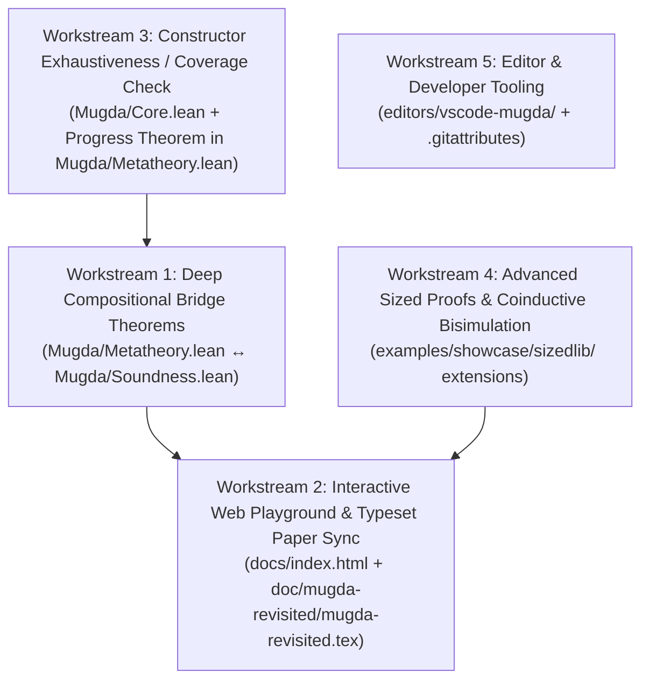

# Mugda — Next Steps & Phase III Roadmap (`NEXT_STEPS_PLAN.md`)

This document outlines the actionable roadmap for the next phase of work on **Mugda (Pure Constructive Lean 4 Edition)**, building on:
- the complete Lean 4 compiler ([`Mugda/Core.lean`](Mugda/Core.lean)),
- the semantic and algorithmic metatheory ([`Mugda/Soundness.lean`](Mugda/Soundness.lean) and [`Mugda/Metatheory.lean`](Mugda/Metatheory.lean)),
- the 3-valued `MatchResult` (`matched` | `mismatch` | `stuck`) fix for open evaluation of overlapping clauses ([`overlap_bug.ma`](examples/counterexamples/overlap_bug.ma)),
- the 9-chapter tutorial ([`tutorial/README.md`](tutorial/README.md)) and 38 tutorial `.ma` files ([`examples/tutorial/`](examples/tutorial/)),
- the `SizedLib` + Verified Expression Compiler showcase ([`examples/showcase/sizedlib/README.md`](examples/showcase/sizedlib/README.md)), and
- the 123-file golden snapshot and JS-vs-Lean differential regression suite ([`tests/golden.sh`](tests/golden.sh), [`tests/js-vs-lean.mjs`](tests/js-vs-lean.mjs)).

---

## Overview of Workstreams



| Workstream | Priority | Target Files | Core Deliverable | Status |
|------------|----------|--------------|------------------|--------|
| **1. Deep Compositional Bridge Theorems** | **High** | [`Mugda/Metatheory.lean`](Mugda/Metatheory.lean), [`Mugda/Soundness.lean`](Mugda/Soundness.lean) | Fuel invariance/determinism (`whnf_atomic_fuel_indep`, `whnf_deterministic`), `$^n` tower reflexivity (`eqVal'_iterVSucc_vgen_refl`, `leqVal'_iterVSucc_vgen_refl`), and end-to-end `checkPattern (.ConP ...)` $\to$ semantic `multi_arg_pattern_refinement_sound` bridge (`checkPattern_conP_inv`, `syntactic_checkPattern_conP_sound_in_ordinal_model`). | **Completed & Verified** |
| **2. Playground UI & Typeset Paper Sync** | **High** | [`docs/index.html`](docs/index.html), [`docs/examples-bundle.js`](docs/examples-bundle.js), [`doc/mugda-revisited/mugda-revisited.tex`](doc/mugda-revisited/mugda-revisited.tex), [`mugda-revisited.pdf`](doc/mugda-revisited/mugda-revisited.pdf) | Added `overlap_bug.ma`, Tutorial (Ch 1–9), and Showcases (`sizedlib.ma`, `bisim.ma`) to the live browser playground, upgraded the Call-Matrix Inspector with idempotent `M = M·M` diagonal witness badges, and recompiled `mugda-revisited.pdf`. | **Completed & Verified** |
| **3. Constructor Exhaustiveness / Coverage Check** | **Medium** | [`Mugda/Core.lean`](Mugda/Core.lean), [`Mugda/Metatheory.lean`](Mugda/Metatheory.lean) | Decidable constructor coverage analysis (`checkConstructorCoverage`, `clausesCoverCon`, `patCoversCon`) + machine-checked progress theorems (`matchList_all_isShallowArgPat`, `matchClause_clauseCoversCon_nullary`, `exhaustive_clauses_nullary_progress`). | **Completed & Verified** |
| **4. Second Showcase: Coinductive Bisimulation** | **Medium** | [`examples/showcase/bisim/`](examples/showcase/bisim/) | Coinductive stream bisimulation (`Bisim A i s1 s2`) proving `bisimRefl`/`bisimSymm`/`bisimTrans`, stream map-fusion, `interleave (evens s) (odds s) ~ s`, and prefix `Eq` extraction (`bisimTakeEq`). | **Completed & Verified** |
| **5. Editor Support (VS Code & GitHub Linguist)** | **Low** | [`editors/vscode-mugda/`](editors/vscode-mugda/), [`.gitattributes`](.gitattributes) | TextMate grammar (`mugda.tmLanguage.json`), `language-configuration.json`, and GitHub Linguist mapping for `.ma` files. | **Completed & Verified** |

---

## Workstream 1: Deep Compositional Bridge Theorems (`Mugda/Metatheory.lean` ↔ `Mugda/Soundness.lean`)

### Motivation
[`Mugda/Metatheory.lean`](Mugda/Metatheory.lean) now covers every compiler pass in [`Mugda/Core.lean`](Mugda/Core.lean) (`leqSize`, `inst`, `eraseSizesVal`, `matchPat`/`matchClauses`, `nocc`/`substVal`, `checkNoccEnv`/`checkNoccDomains`, `SPos`, `eqVal'`/`leqVal'`/`leqApp`, `checkPattern`/`checkDot`, `checkType`/`checkExpr`/`inferExpr`, and `Order`/`checkAll`/`collectCallsExpr`). The next step is proving the **compositional big-step theorems** across recursive calls and fuel bounds.

### Concrete Tasks & Theorems

1. **§2C — Fuel Monotonicity & Determinism of NbE (`whnf`, `app`, `matchClauses`, `force`):**
   - Prove that `.stuck` and `.mismatch` in `matchPat` / `matchList` / `matchClause` are fuel-invariant once sub-evaluations stabilize, and that if `whnf fuel e env = .ok v` (or `matchClauses fuel cs vs = .ok v`), then for every `fuel' ≥ fuel`, `whnf fuel' e env = .ok v`.
   - Immediate corollary (`eval_deterministic`): any two successful evaluations at fuels `f1` and `f2` produce identical values `v1 = v2`.

2. **§3C+ — Full Structural Equivalence & Preorder Laws for `eqVal'` and `leqVal'`:**
   - Extend `eqVal'_base_refl` (`VSet`, `VSize`, `VInfty`, `VGen`) to full structural induction over first-order values (`VSucc`, `VCon`, neutral `VApp`) given sufficient fuel (`fuel ≥ depth v`).
   - Prove symmetry (`eqVal'_symm`) and transitivity (`eqVal'_trans`, `leqVal'_trans`) on canonical/neutral values without coinductive unfolding cycles.

3. **§3D+ — End-to-End Syntactic-to-Semantic Pattern Refinement Bridge (`checkPattern_conP_sound_refinement`):**
   - Prove the direct inversion lemma for the `.ConP` branch of `checkPattern` in [`Mugda/Core.lean`](Mugda/Core.lean#L868-L934):
     - Whenever `checkPattern fuel (.ConP co c pl) vA vB st = .ok (patVal, st')`, every variable `(i, v)` in the unification map `sub` that satisfies `isNewSuccRefinement i v` passes both `checkNoccEnv i st.gamma` and `checkNoccDomains fuel i vB'`.
   - Combine this with `checkNoccEnv_forall_mem`, `checkNoccDomains_pi`, and `nocc_substVal_id_of_normSizeOrAtom` to obtain a single bridge theorem feeding directly into `multi_arg_pattern_refinement_sound` in [`Mugda/Soundness.lean`](Mugda/Soundness.lean#L372-L384).

### Verification Gate
- `lake build Mugda.Metatheory` succeeds with zero `sorry`, zero `partial`, and zero warnings.

---

## Workstream 2: Interactive Web Playground Upgrade & Typeset Paper Sync

### 2A. Web Playground (`docs/index.html` & `docs/mugda-engine.js`)

1. **Expanded Example Selector in [`docs/index.html`](docs/index.html):**
   - **Counterexamples Group:** Add [`overlap_bug.ma`](examples/counterexamples/overlap_bug.ma) (`isz zero = tt; isz x = ff` proving `Eq Bool tt ff` in **2008 Original** mode vs. rejected with `eqVal error` in **2026 Fixed** mode) and [`loop_deep.ma`](examples/counterexamples/loop_deep.ma).
   - **Tutorial Group (Chapters 1–9):** Add the 9 flagship tutorial examples (`01_first_steps.ma` through `09_soundness_ok.ma`) so readers of [`tutorial/`](tutorial/README.md) can run and edit every chapter in one click in the browser.
   - **Showcase Group:** Add [`sizedlib.ma`](examples/showcase/sizedlib/sizedlib.ma) (*SizedLib + Verified Expression Compiler*).

2. **Interactive SCT Call-Matrix Inspector Panel:**
   - Expose the `ORDER_+` call matrices and idempotent completion computed in [`docs/mugda-engine.js`](docs/mugda-engine.js) in a collapsible UI tab (*"Termination Matrices"*) in `docs/index.html`, showing:
     - Each extracted call `f -> g` with its matrix over `{<, <=, ?, Mat(...)}`,
     - The Kleene-star idempotent matrices $M = M \cdot M$, and
     - The highlighted strictly decreasing diagonal witness (`<`) that certifies termination/productivity (or the offending idempotent matrix without `<` when termination fails).

### 2B. Typeset Paper Sync (`doc/mugda-revisited/mugda-revisited.tex` & `.pdf`)

1. Update [`doc/mugda-revisited/mugda-revisited.tex`](doc/mugda-revisited/mugda-revisited.tex) to match [`MUGDA_REVISITED.md`](MUGDA_REVISITED.md):
   - Add **Bug 7 (Open Evaluation of Overlapping Clauses & 3-Valued `MatchResult`)** with the 6-line `isz` / `bad` counterexample and the `matched | mismatch | stuck` semantics.
   - Expand the **Machine-Checked Metatheory** table to include §2B (`matchClauses`), §3B (`SPos`), §3C (`eqVal`/`leqVal`/`leqApp`), §3D (`checkPattern`/`checkDot`), and §3E (`checkType`/`checkExpr`/`inferExpr`).
   - Add a **Case Study** subsection summarizing the ~1,100-line `SizedLib` + Verified Expression Compiler development ([`examples/showcase/sizedlib/sizedlib.ma`](examples/showcase/sizedlib/sizedlib.ma)).
2. Recompile [`doc/mugda-revisited/mugda-revisited.pdf`](doc/mugda-revisited/mugda-revisited.pdf) via `pdflatex` and verify clean layout and zero undefined references.

---

## Workstream 3: Constructor Exhaustiveness / Coverage Check & Progress Theorem

### Motivation
Following 2008 MiniAgda (Thesis §3.5 *"Coverage of pattern matching"*), Mugda checks size-pattern completeness (`completePatterns` in [`Mugda/Core.lean`](Mugda/Core.lean#L97-L115)) to forbid `.SuccP` in inductive functions, but does not check **constructor exhaustiveness**. For instance:
- `fun notLt0 : (n : Nat) -> Lt n zero -> Empty {}` in [`examples/acc.ma`](examples/acc.ma) is legitimate because `Lt n zero` has no constructors targeting index `zero`;
- By contrast, `fun bogus : Nat -> Empty {}` or omitting the `zero` clause in a function on `Nat` is silently accepted without warning.

### Design (Preserving 100% Backwards Compatibility)
1. **Non-Fatal Coverage Warning (Mirroring `completePatterns`):**
   - Implement `checkCoverageClauseList` in [`Mugda/Core.lean`](Mugda/Core.lean) (and [`docs/mugda-engine.js`](docs/mugda-engine.js)):
     - For each inductive parameter position split by constructor patterns across a function's clauses, compare the set of matched constructors against the datatype's constructors whose target indices unify with the expected domain indices.
     - If an inhabited constructor is missing (and no catch-all `.VarP` covers the position), emit a non-fatal warning (`coverage check fails for [f]`, analogous to `size pattern incomplete for [f]`) and mark `f` as non-reducing (`isComplete = false`).
   - Crucially, absurd/uninhabited inductive families (such as `Empty` or `Lt n zero` in `examples/acc.ma`, where zero constructors unify with the target index `zero`) have an empty set of possible constructors and therefore **pass coverage with zero warnings**!
2. **Machine-Checked Progress Theorem in [`Mugda/Metatheory.lean`](Mugda/Metatheory.lean):**
   - Prove `exhaustive_clauses_never_mismatch`: for any single-argument clause list covering every constructor of datatype `D`, matching a closed canonical constructor value `VCon c args` of `D` never returns `.mismatch`.

---

## Workstream 4: Second Showcase — Coinductive Bisimulation & Total Normalizer

Extend [`examples/showcase/`](examples/showcase/) with two self-contained developments that highlight **dependent proofs over sized inductive and coinductive types**:

1. **Coinductive Stream Bisimulation (`examples/showcase/bisim/bisim.ma`):**
   - Define sized stream bisimulation ($\approx_i$) as a `sized codata` family indexed by two streams and a size bound `i : Size`:
     ```mugda
     sized codata Bisim (A : Set) : Stream A # -> Stream A # -> Size -> Set
     { bisimCons : (i : Size) -> (x : A) -> (xs : Stream A #) -> (ys : Stream A #) ->
                   Bisim A xs ys i ->
                   Bisim A (scons A # x xs) (scons A # x ys) ($ i)
     }
     ```
   - Prove by `cofun` (certified productive by Mugda's size-change termination checker!):
     - Reflexivity (`bisimRefl`), symmetry (`bisimSymm`), and transitivity (`bisimTrans`) of `Bisim`;
     - Stream functor laws: `map id s ≈ s` and `map f (map g s) ≈ map (f ∘ g) s`;
     - Interleaving identity: `interleave (evens s) (odds s) ≈ s`.

2. **Sized Fuel-Free Evaluator / Normalizer (`examples/showcase/sizedlib/`):**
   - Use `SNat` / `Tree` size bounds to write a total evaluation/normalization pass that terminates directly by sized recursion without an artificial `Nat` fuel counter.

---

## Workstream 5: Editor & Developer Tooling

1. **VS Code / VSCodium Extension (`editors/vscode-mugda/`):**
   - `package.json`, `language-configuration.json`, and `syntaxes/mugda.tmLanguage.json` highlighting keywords (`data`, `codata`, `sized`, `fun`, `cofun`, `mutual`, `let`, `in`, `eval`, `Set`, `Size`), size operators (`$`, `#`), polarities (`+`, `-`), dot patterns (`.(...)`), comments (`--`, `{- ... -}`), and identifiers.
2. **GitHub Linguist Syntax Highlighting (`.gitattributes`):**
   - Map `*.ma` to Agda/Haskell highlighting on GitHub (`*.ma linguist-language=Agda`) so all 123 `.ma` files render with syntax highlighting in GitHub's web viewer.
